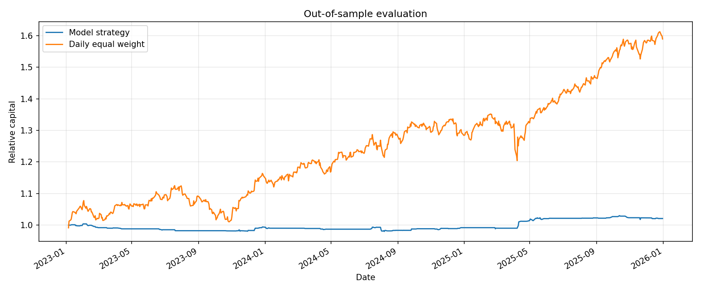
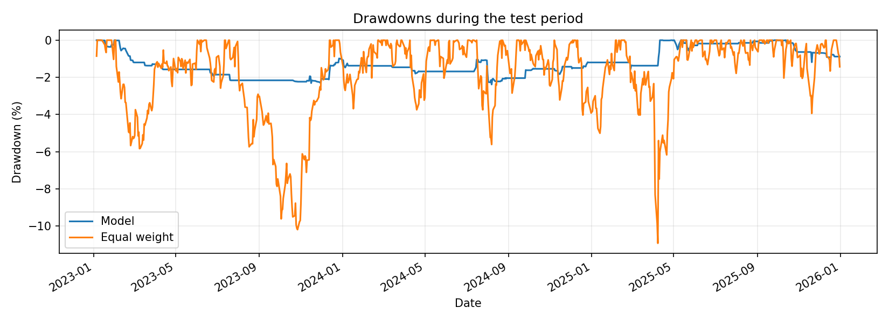

# Project results

## What I found

The decision tree was selected on validation. Its test accuracy was 54.25%, compared with 53.90% for always predicting a positive return. That is a difference of 0.35 percentage points. The gap is small. I did not run a statistical significance test to establish whether it holds beyond this sample. Observations from different ETFs on the same date are also not independent.

| Metric | Model strategy | Daily equal weight |
|---|---:|---:|
| Total return | 2.09% | 58.95% |
| Compound annual growth rate | 0.70% | 16.85% |
| Annualized volatility | 1.56% | 10.98% |
| Maximum drawdown | -2.38% | -10.93% |
| Sharpe (risk-free rate = 0%) | 0.453 | 1.473 |

Selecting ETFs with the model did not improve returns in this simulation. The strategy gained 2.09%, while the equal-weight benchmark gained 58.95%. The strategy also had a lower Sharpe ratio.

Its maximum drawdown was smaller, but it also invested less capital because allocations stayed in cash when there was no signal. I cannot attribute the smaller drawdown only to better ETF selection. A comparison with similar invested exposure would help separate these effects.

What stood out to me was that getting slightly more predictions right did not lead to making more money. The size of each gain and loss, trading costs, and the amount of capital left in cash also matter.

I kept the parameters fixed after looking at test results. If I continue with other features or a different rebalancing frequency, I will need another evaluation period rather than choosing rules that fit these test results.

